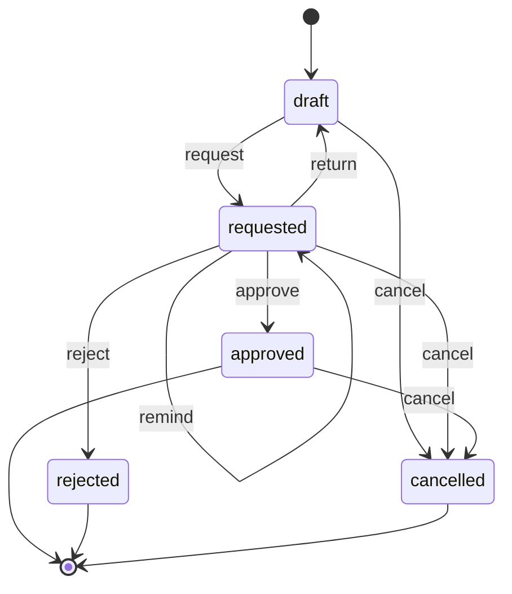

# States and transitions

A document is always in exactly one state, and it changes state only
along a transition its class names. Together the states and the
transitions are the process of the class. This chapter says what a
transition is, which two questions the engine asks before every move,
and what a final state means.

## The class

A request for leave. An employee writes it, their manager decides.

```json
{
  "name": "Leave",
  "title": "\"Leave of \" & employee",
  "variables": {
    "employee": {"type": "text", "default": "USER()"},
    "manager":  {"type": "text", "required": true},
    "days":     {"type": "int", "min": 1, "required": true},
    "comment":  {"type": "text"}
  },
  "states": {"initial": "draft", "list": ["draft", "requested", "approved", "rejected", "cancelled"], "final": ["approved", "rejected", "cancelled"]},
  "transitions": [
    {"name": "request", "from": "draft",     "to": "requested", "guard": "days <= 30"},
    {"name": "remind",  "from": "requested", "to": "requested"},
    {"name": "return",  "from": "requested", "to": "draft"},
    {"name": "approve", "from": "requested", "to": "approved"},
    {"name": "reject",  "from": "requested", "to": "rejected",  "guard": "NOT ISBLANK(comment)"},
    {"name": "cancel",  "from": ["draft", "requested", "approved"], "to": "cancelled"}
  ],
  "access": {
    "read":   "employee = USER() OR manager = USER()",
    "create": "INGROUP(\"everyone\")",
    "update": "employee = USER() AND STATE() = \"draft\"",
    "delete": "FALSE",
    "transition": {
      "request": "employee = USER()",
      "remind":  "employee = USER()",
      "return":  "manager = USER()",
      "approve": "manager = USER()",
      "reject":  "manager = USER()",
      "cancel":  "employee = USER()"
    }
  },
  "rights": {
    "*": {
      "*":       {"write": "employee = USER()"},
      "comment": {"write": "manager = USER()"}
    }
  }
}
```

## The chart

The same states and transitions, drawn. A new request starts in
`draft`; `approved`, `rejected` and `cancelled` are final.



## What it does

Ola asks for leave. Marek is her manager.

| Step | Who | Does | Answer |
|---|---|---|---|
| 1 | Ola | creates a request for 45 days, with Marek as manager | allowed, state `draft` |
| 2 | Ola | requests it | refused, `guard_false` |
| 3 | Ola | requests it, setting the days to 10 in the same call | allowed, state `requested` |
| 4 | Ola | approves it | refused, `forbidden` at `/access/transition/approve` |
| 5 | Marek | rejects it, with no comment | refused, `guard_false` |
| 6 | Ola | reminds | allowed, state `requested` |
| 7 | Marek | returns it | allowed, state `draft` |
| 8 | Ola | sets the days to 12 | allowed |
| 9 | Ola | requests it again | allowed, state `requested` |
| 10 | Marek | approves it, setting the days to 300 in the same call | refused, `forbidden`, variable `days` |
| 11 | Marek | approves it | allowed, state `approved` |
| 12 | Ola | writes a comment | refused, `terminal` |
| 13 | Marek | returns it | refused, `wrong_state` |
| 14 | Ola | cancels it | allowed, state `cancelled` |
| 15 | Ola | cancels it again | refused, `wrong_state` |

## A transition

A transition has a name, the state it leaves and the state it enters.

- **It is taken by its name.** A caller says "take `approve` on this
  request". Nobody sets the state as a value.
- **It is one commit.** The move makes one new version of the document
  and one event in the log, or nothing.
- **It may carry values.** In step 3 Ola sets the days and requests in
  one call. The values are applied first, the computed variables are
  worked out, and then the guard is asked, so the guard sees the
  document as the call would leave it.
- **One name, several starting states.** `cancel` leaves `draft`,
  `requested` or `approved`: `from` is a list. A name is used once in
  a class.

## Two questions before every move

| Question | Asked of | Answered by | A no is |
|---|---|---|---|
| May this caller take it? | the caller, over the document as it is stored | the line of the transition under `access.transition` | `forbidden`, with that line |
| Does the document allow it? | the document, with the values of the call applied | the `guard` of the transition | `guard_false`, with the guard |

They are asked in that order. In step 4 Ola is refused before any
guard is looked at; in step 5 Marek may reject, and the request does
not allow it yet, because a rejection needs a comment.

Keep the two apart when you write a class. A guard is about the
document: is the amount filled in, is the leave short enough. Who may
is about the caller, and belongs under `access`. A caller can do
something about `guard_false`, by completing the document, and nothing
about `forbidden`.

A transition with no line of its own under `access.transition` asks
`update` instead: who may change the document may move it.

## The values that come with a transition

A transition that has its own line is not asked `update`. So what its
caller may set in the same call is decided by `rights` alone.

Marek may not change a request: `update` lets only the employee, and
only in `draft`. He may take `approve`, and he may give values with
it. Without the `rights` block of this class he could approve the
request and set its days to 300 in one call. The block closes that:
every variable is written by the employee, and `comment` by the
manager. Step 10 is refused with the variable it names, and in a
rejection Marek gives the comment with the move:
`reject` with `comment` "busy week".

**When a class gives a transition to somebody who may not edit the
document, say in `rights` what they may set.**

## What is open now

For a document, the engine lists the transitions that leave its state
and says for each whether this caller may take it now, and why not.
For the request in `requested`, before anybody wrote a comment:

<!-- what is open in requested -->
| Transition | Leads to | For Marek | For Ola |
|---|---|---|---|
| `remind` | `requested` | no: `forbidden` | yes |
| `return` | `draft` | yes | no: `forbidden` |
| `approve` | `approved` | yes | no: `forbidden` |
| `reject` | `rejected` | no: `guard_false` | no: `forbidden` |
| `cancel` | `cancelled` | no: `forbidden` | yes |

This is what a screen shows as buttons, and what an agent reads to
know what it can do next. A preview goes one step further: it runs a
move with its values and answers what would happen, writing nothing.

## A move into the same state

`remind` leaves `requested` and enters `requested`. It is a move like
any other: a new version, an event, and the state is left and entered
again. The rules of the class that run on leaving a state and on
entering it both run, and the time the document entered its state
starts anew.

## Final states

A document in a final state is finished.

- **Its values cannot change.** Step 12 is refused with `terminal`.
- **It can only move to another final state.** Step 14 does: an
  approved leave is cancelled. A class with a transition from a final
  state to one that is not final is refused when it is defined.
- **It cannot be deleted**, and it keeps the version of the class it
  was finished under.

Make a state final when what it says must stay true: booked, approved,
rejected.

## Moves the engine makes by itself

A transition can carry a time, `after` or `at`. When that time comes
the engine takes it, as a commit like any other. The guide
[A reminder every seven days, and a
deadline](../guides/reminders-and-deadlines.md) shows both.

> **Status.** The engine can also make a move as soon as a guard comes
> to hold, with no time involved. Today that form is written without a
> name. The owner ruled on 2026-11-13 that every transition has a name
> and an automatic one carries a mark; that is not built yet, and this
> chapter will show the form when it is.

## What the log keeps

Every move is an event. These are the events of Ola's request, in
order:

<!-- the events -->
| Event | Transition | From | To | By |
|---|---|---|---|---|
| `created` | | | `draft` | ola |
| `transition` | `request` | `draft` | `requested` | ola |
| `transition` | `remind` | `requested` | `requested` | ola |
| `transition` | `return` | `requested` | `draft` | marek |
| `set` | | | | ola |
| `transition` | `request` | `draft` | `requested` | ola |
| `transition` | `approve` | `requested` | `approved` | marek |
| `transition` | `cancel` | `approved` | `cancelled` | ola |

The refused steps are not in it: a refusal writes nothing.

A formula can read this life of its document: `STATE()` for the state
it is in, `ENTEREDAT()` for when it entered it, `ENTRIES("requested")`
for how often it was requested, `DAYSIN("requested")` for how long it
waited there in all. They are in [The functions](../functions.md),
under "The caller, the clock and the document".

## What is checked when the class is defined

<!-- checked when the class is defined -->
| The class | Code |
|---|---|
| names a state in a transition, or as `initial`, that is not in `list` | `unknown_state` |
| uses the name of a transition twice | `duplicate` |
| has a guard that is not a condition | `not_a_condition` |
| leads from a final state to one that is not final | `not_allowed` |

Two things the engine does not check, so read the chart: a state that
no transition reaches, and a state that is not final and that no
transition leaves. Both are accepted without a remark.

## What is refused

<!-- what is refused -->
| The caller | Code |
|---|---|
| takes a transition the class does not have | `unknown_transition` |
| takes a transition that does not leave the state the document is in | `wrong_state` |
| may not take it | `forbidden` |
| may take it, and the guard does not hold | `guard_false` |
| gives a value with it that they may not write | `forbidden`, with the variable |
| changes a value of a document in a final state | `terminal` |

A refusal says what would help: `wrong_state` names the transitions
that do leave the state, `unknown_transition` the transitions the
class has, `guard_false` the guard.
